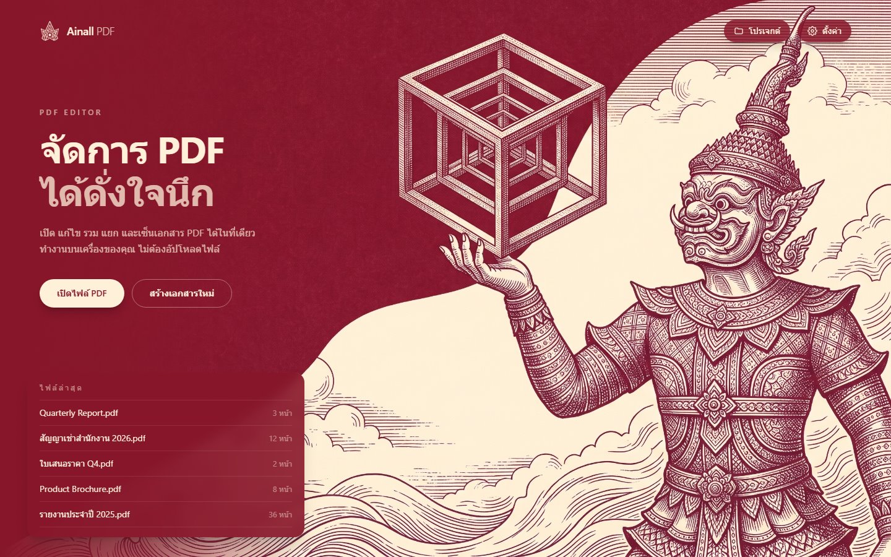
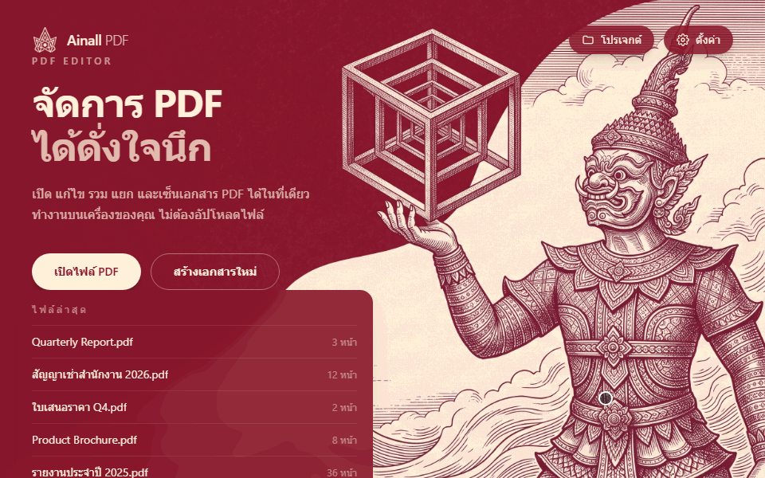
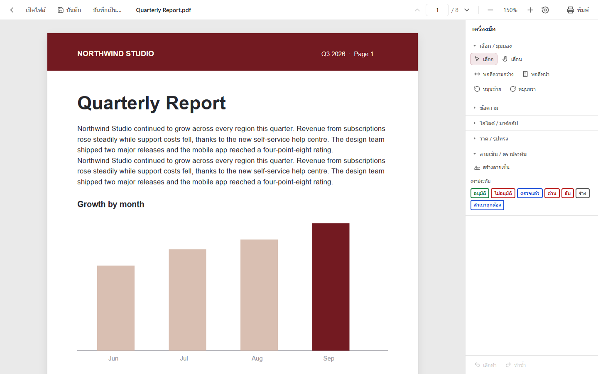
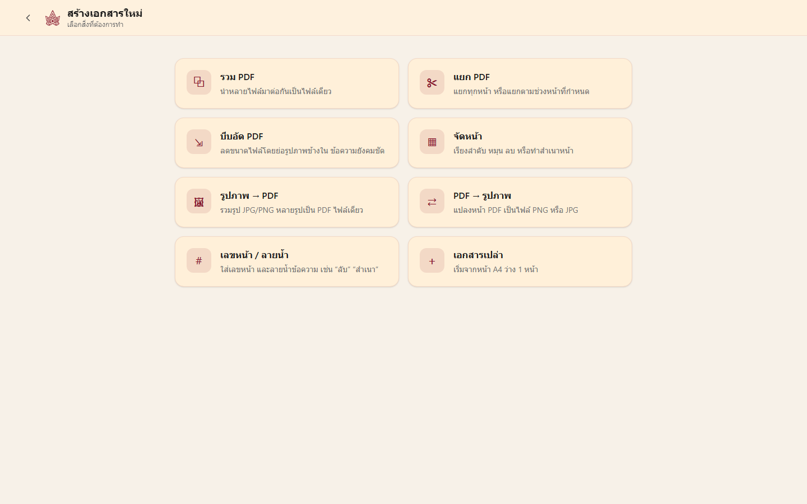
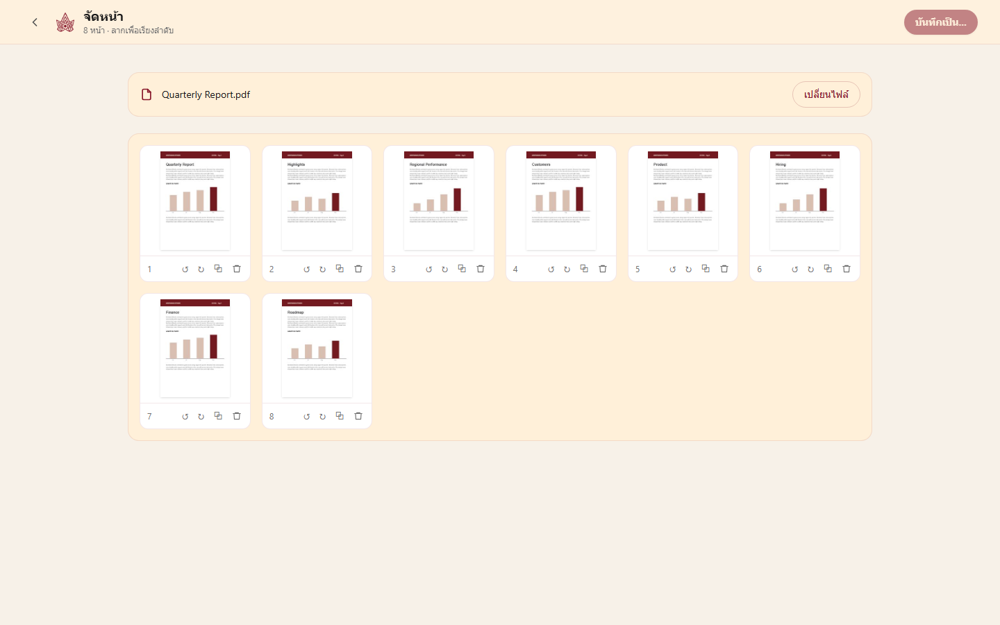
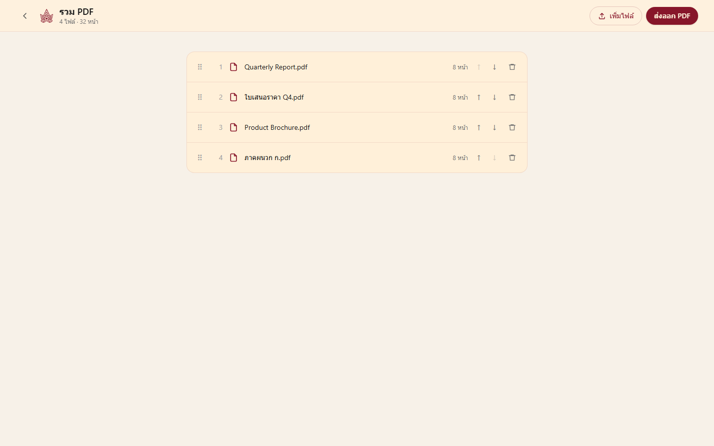
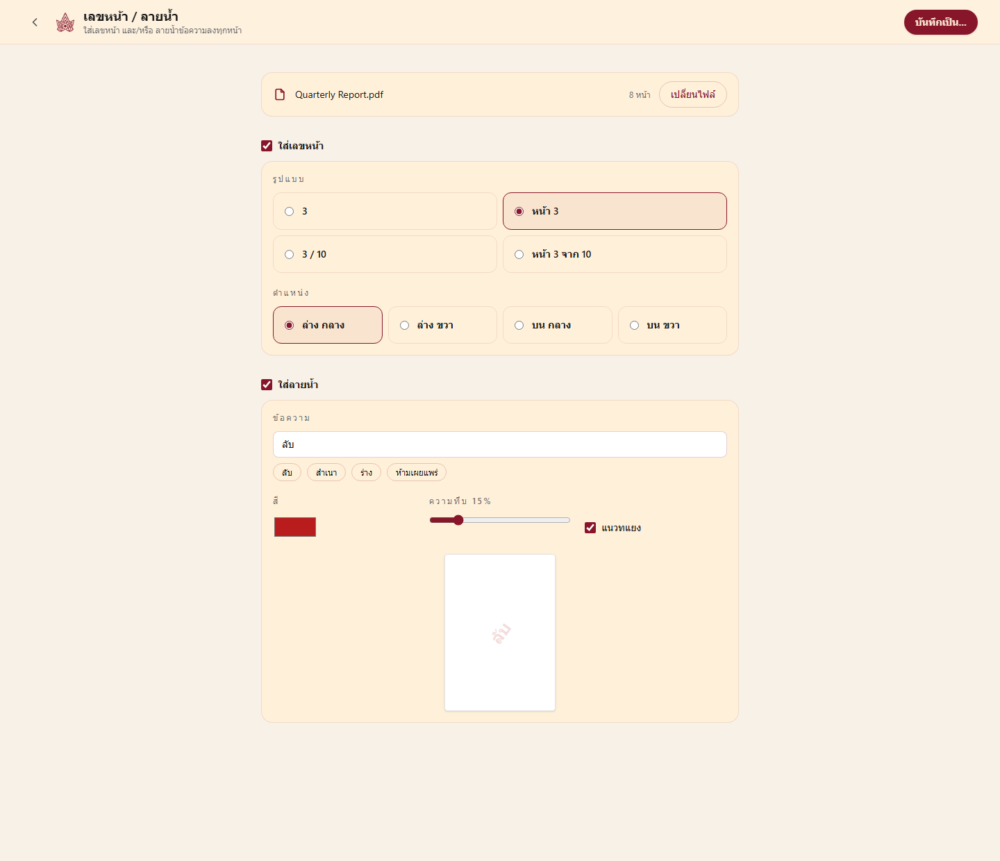
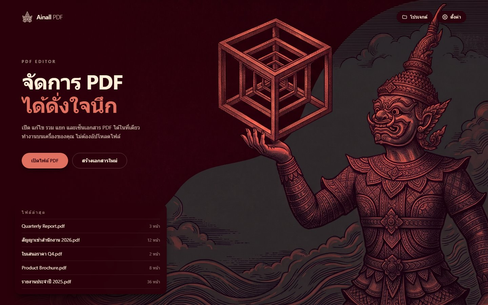

<div align="center">


# Ainall PDF

**จัดการ PDF ได้ดั่งใจนึก**

เปิด อ่าน เขียน เซ็น รวม แยก บีบอัด และจัดหน้า PDF ได้ในแอปเดียว
ทำงานบนเครื่องของคุณทั้งหมด ไม่ต้องอัปโหลดไฟล์ขึ้นที่ไหน




</div>

---

## ทำอะไรได้บ้าง

<div align="center">

</div>

### อ่านและแก้ไข

| | |
|---|---|
| **Viewer ความเร็วสูง** | ใช้ pdf.js อ่านไฟล์ทีละช่วง (range request) ไฟล์ใหญ่ก็เปิดเร็ว ไม่ต้องโหลดทั้งไฟล์ก่อน |
| **เขียนลงเอกสาร** | พิมพ์ข้อความ ไฮไลต์ ขีดเส้นใต้ ขีดฆ่า วาดเส้น ลูกศร กรอบ วงรี ปรับสีและความหนาได้ |
| **ลายเซ็นและตราประทับ** | วาดหรือพิมพ์ลายเซ็น และตราสำเร็จรูป เช่น อนุมัติ ตรวจแล้ว ลับ สำเนาถูกต้อง |
| **บันทึกลงไฟล์จริง** | สิ่งที่เขียนถูกฝังลงหน้า PDF เปิดในโปรแกรมไหนก็เห็นเหมือนกัน พร้อม Undo / Redo |
| **พิมพ์** | เลือกช่วงหน้า พิมพ์ที่ 150 DPI |

### เครื่องมือ PDF

กดปุ่ม **สร้างเอกสารใหม่** ที่หน้าแรก จะเจอเมนูเครื่องมือทั้งหมด

| เครื่องมือ | รายละเอียด |
|---|---|
| **รวม PDF** | เพิ่มหลายไฟล์ ลากเรียงลำดับ รวมเป็นไฟล์เดียว แล้วเปิดดูทันที |
| **แยก PDF** | แยกทุกหน้า หรือกำหนดช่วงเอง เช่น `1-3, 5, 8-` ได้ 1 ไฟล์ต่อ 1 ช่วง |
| **บีบอัด PDF** | ย่อรูปภาพข้างในไฟล์ 3 ระดับ ข้อความและเส้นยังคมชัด เลือกได้ก่อนว่าจะเล็กลงเท่าไร |
| **จัดหน้า** | ภาพย่อทุกหน้า ลากเรียง หมุน ทำสำเนา ลบหน้า |
| **รูปภาพ → PDF** | รวม JPG / PNG เป็น PDF หน้า A4 หรือตามสัดส่วนรูป หมุนรูปจากมือถือให้ตรงอัตโนมัติ |
| **PDF → รูปภาพ** | แปลงทุกหน้าหรือบางหน้าเป็น PNG / JPG ที่ 72, 150 หรือ 300 DPI |
| **เลขหน้า / ลายน้ำ** | ใส่เลขหน้า 4 รูปแบบ 4 ตำแหน่ง และลายน้ำข้อความภาษาไทย ปรับสี ความทึบ แนวทแยง |

### อื่นๆ

- **โปรเจกต์** จัดกลุ่มไฟล์ PDF เป็นโฟลเดอร์ พร้อมภาพย่อหน้าแรก
- **ไฟล์ล่าสุด** กลับมาเปิดไฟล์ที่ใช้บ่อยได้ในคลิกเดียว
- **Open with** ลงทะเบียนกับ Windows ให้คลิกขวาไฟล์ PDF แล้วเลือก Ainall PDF ได้ ถ้าแอปเปิดอยู่จะส่งไฟล์ไปเปิดในหน้าต่างเดิม
- **ธีมสว่าง / มืด** ตามระบบ หรือเลือกเอง
- **ไฟล์ต้นฉบับปลอดภัย** เครื่องมือทุกตัวบันทึกเป็นไฟล์ใหม่ ส่วนการบันทึกใน Viewer เขียนลงไฟล์ชั่วคราวก่อนแล้วค่อยสลับ ไฟล์ไม่พังถ้าบันทึกล้มกลางทาง

---

## ภาพหน้าจอ

<table>
  <tr>
    <td width="50%"><br /><sub><b>Viewer</b> พร้อมแถบเครื่องมือเขียน ไฮไลต์ วาด และลายเซ็น</sub></td>
    <td width="50%"><br /><sub><b>เมนูเครื่องมือ</b> หลังกดสร้างเอกสารใหม่</sub></td>
  </tr>
  <tr>
    <td><br /><sub><b>จัดหน้า</b> ลากเรียง หมุน ทำสำเนา ลบ</sub></td>
    <td><br /><sub><b>รวม PDF</b> ลากที่ไอคอน ⠿ เพื่อเรียงลำดับ</sub></td>
  </tr>
  <tr>
    <td><br /><sub><b>เลขหน้า / ลายน้ำ</b> พร้อมตัวอย่างก่อนบันทึก</sub></td>
    <td><br /><sub><b>ธีมมืด</b></sub></td>
  </tr>
</table>

---

## ติดตั้ง

ดาวน์โหลดตัวติดตั้งจากหน้า [Releases](https://github.com/EndFroZen/Ainall_PDF/releases) หรือ build เองตามหัวข้อ [พัฒนาต่อ](#พัฒนาต่อ) แล้วเลือกแบบใดแบบหนึ่ง

| ไฟล์ | ใช้เมื่อ |
|---|---|
| `Ainall PDF_x.y.z_x64-setup.exe` | ติดตั้งทั่วไป (NSIS) แนะนำ |
| `Ainall PDF_x.y.z_x64_en-US.msi` | ติดตั้งผ่านระบบขององค์กร / Group Policy |

ต้องมี Microsoft Edge WebView2 Runtime ซึ่ง Windows 10 และ 11 ส่วนใหญ่มีอยู่แล้ว ถ้าไม่มี ตัวติดตั้งจะดาวน์โหลดให้เอง

> **ตั้งเป็นโปรแกรมเปิด PDF หลัก** Windows ไม่อนุญาตให้แอปตั้งค่านี้เอง ให้คลิกขวาไฟล์ PDF แล้วเลือก Open with → Choose another app → Ainall PDF → ติ๊ก Always use this app

---

## พัฒนาต่อ

### สิ่งที่ต้องมี

- [Node.js](https://nodejs.org) 22.6 ขึ้นไป
- [Rust](https://rustup.rs) (stable)
- [ข้อกำหนดของ Tauri บน Windows](https://tauri.app/start/prerequisites/) (Microsoft C++ Build Tools, WebView2)

### คำสั่ง

```sh
npm install
npm run tauri dev      # เปิดแอปแบบ dev พร้อม hot reload
npm run tauri build    # สร้างตัวติดตั้งที่ src-tauri/target/release/bundle/
```

### Self-check

ส่วนที่เป็นตรรกะล้วนมีสคริปต์ตรวจสอบเล็กๆ รันด้วย Node ได้เลยโดยไม่ต้องเปิดแอป

```sh
node scripts/check-ranges.ts     # ตัวแปลงช่วงหน้า "1-3, 5, 8-"
node scripts/check-compress.ts   # การเลือกและแทนที่รูปตอนบีบอัด
node scripts/check-stamp.ts      # ตำแหน่งเลขหน้า / ลายน้ำบนหน้าที่ถูกหมุน 0 / 90 / 180 / 270 องศา
node scripts/check-bake.ts       # การฝังสิ่งที่เขียนลงหน้า PDF
```

---

## สถาปัตยกรรม

```
┌──────────────────────────── WebView2 (React + TypeScript) ────────────────────────────┐
│                                                                                       │
│   pdf.js ──────── แสดงผล, ภาพย่อ, แปลงเป็นรูป                                          │
│   pdf-lib ─────── รวม, แยก, จัดหน้า, บีบอัด, เลขหน้า, ลายน้ำ, ฝัง annotation            │
│   Canvas ──────── วาดข้อความไทยเป็นภาพ, ย่อ / เข้ารหัส JPEG ใหม่                        │
│                                                                                       │
└──────────┬──────────────────────────────┬─────────────────────────────┬───────────────┘
           │ asset protocol               │ invoke (raw bytes)          │ plugin-sql
           │ อ่านไฟล์แบบ range request     │                             │
┌──────────▼──────────────────────────────▼─────────────────────────────▼───────────────┐
│  Rust (Tauri 2)                                                                       │
│  files.rs      เขียนไฟล์แบบ atomic, ไม่เขียนทับเมื่อขอ (ชื่อ (2), (3) …)                 │
│  projects.rs   โฟลเดอร์โปรเจกต์, import / rename / delete                              │
│  lib.rs        SQLite migrations, single instance, เปิดไฟล์จาก "Open with"            │
└───────────────────────────────────────────────────────────────────────────────────────┘
```

**ทำไมภาษาไทยในลายน้ำและตราประทับถึงถูกต้อง** ฟอนต์มาตรฐานของ PDF ไม่มีอักษรไทย แทนที่จะฝังฟอนต์ทั้งตัว แอปวาดข้อความลง Canvas ด้วยฟอนต์ของระบบ (Leelawadee UI) แล้วฝังเป็นภาพ สระและวรรณยุกต์จึงวางถูกที่เสมอ

**ทำไมบีบอัดแล้วข้อความยังคม** เครื่องมือบีบอัดแตะเฉพาะรูป JPEG ข้างในไฟล์ ย่อขนาดและเข้ารหัสใหม่ ส่วนข้อความ เส้น และฟอนต์ไม่ถูกเปลี่ยน

### โครงสร้างโปรเจกต์

```
src/
├── pages/          หน้าจอ: Landing, Viewer, Projects, Tools และเครื่องมือแต่ละตัว
├── components/     ToolKit (drop zone, ลากเรียง, ตัวเลือก), AnnotationLayer, ToolPanel, Dialogs
└── lib/
    ├── pdf.ts          เปิด / บันทึก / รวม / แยก / บีบอัด
    ├── tools.ts        รูปภาพ ⇄ PDF, จัดหน้า, เลขหน้า / ลายน้ำ
    ├── annotations.ts  โมเดลและการฝัง annotation
    ├── compress.ts     บีบอัดรูป JPEG ในไฟล์
    ├── stamp.ts        คำนวณตำแหน่งบนหน้าที่ถูกหมุน
    └── db.ts           SQLite: ไฟล์ล่าสุด, การตั้งค่า
src-tauri/
├── src/            คำสั่งฝั่ง Rust
└── tauri.conf.json การตั้งค่าแอป, file association, asset scope
scripts/            self-check และสคริปต์คัดลอกไฟล์ของ pdf.js
```

---

<div align="center">
<sub>Built with Tauri, React and a lot of ลายไทย</sub>
</div>
